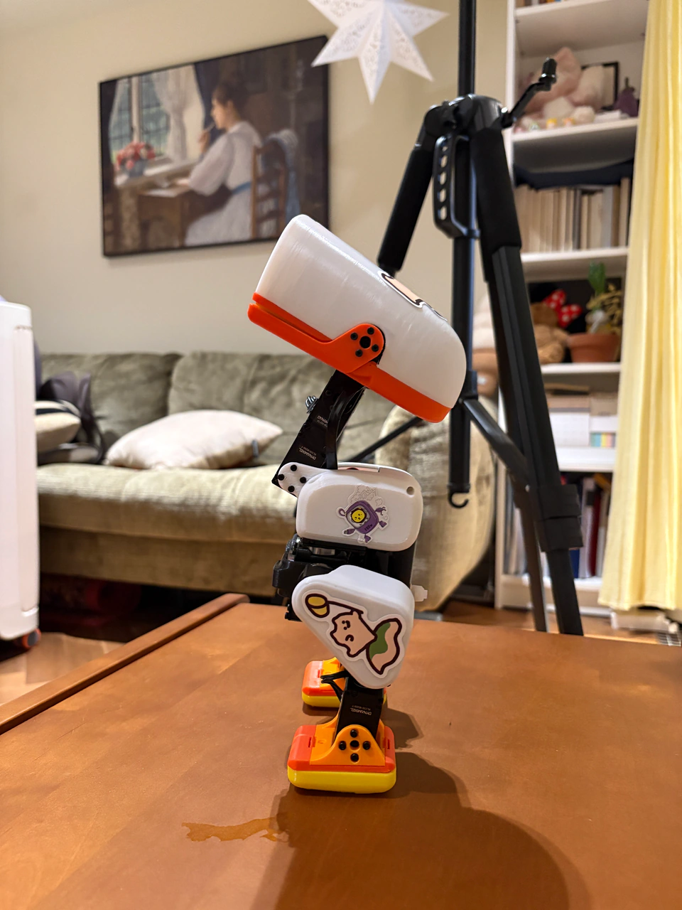
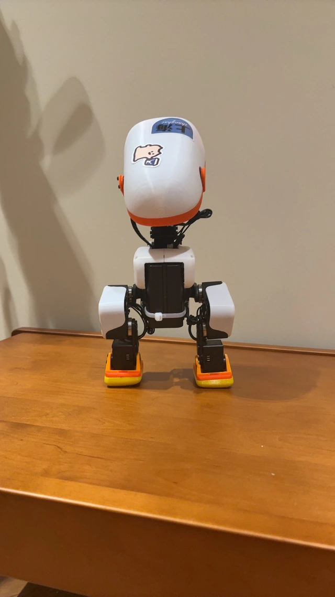
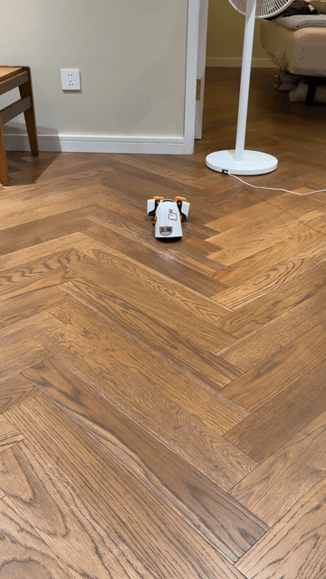
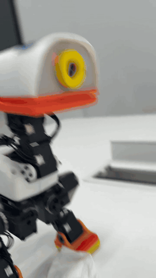

<p align="center"><a href="README.md">简体中文</a> · <strong>English</strong></p>

# Fanduck · Microduck Replication Complete

> **Built from the official project:** Our replica is based on the [Microduck code](https://github.com/pollen-robotics/microduck) and [robot models](https://github.com/pollen-robotics/microduck_rl) published by Pollen Robotics. Thank you to the official team for sharing their work!

**[Official project](https://github.com/pollen-robotics/microduck) · [Official website](https://pollen-robotics.com/microduck/) · [Our website](https://duck.fandcode.com/)**

**We have successfully built our Microduck replica!** From sourcing parts and 3D printing to assembly and debugging, we completed the build from scratch. The photos and videos below show our actual robot.

Fanduck is an unofficial personal research replication of Pollen Robotics Microduck. This repository shares the materials we used: a parts list, 3D-print files, board files, making tools, and a workbench for observing the robot's 3D pose. It mirrors the build resources available on our project website.

## Our Duck

<p align="center">
  
  
</p>

## Real Robot Demos

**Demo 1**

<p align="center">
  
</p>

**Demo 2**

<p align="center">
  
</p>

## Build Resources

Current resource version: `maker-20260916`. These four ZIP files are identical to the files in our website's release directory.

| Package | Contents | Download |
| --- | --- | --- |
| Materials and 3D-print files | Parts list, categorized print files with Chinese names, and assembly drawings | [ZIP · 12.7 MB](downloads/maker-20260916/fanduck-materials-print-20260916.zip?raw=true) |
| Board manufacturing files | Robot HAT, battery contact board, and NFC design and manufacturing files | [ZIP · 31.3 MB](downloads/maker-20260916/fanduck-boards-20260916.zip?raw=true) |
| Making tools source code | Scripts and inputs for generating print revisions and checking geometry | [ZIP · 1.1 MB](downloads/maker-20260916/fanduck-making-tools-20260916.zip?raw=true) |
| 3D observation workbench source code | 3D pose display, read-only joint data collection, and optional camera viewing | [ZIP · 2.6 MB](downloads/maker-20260916/fanduck-mirror-workbench-20260916.zip?raw=true) |

Start with **Materials and 3D-print files** and open `01_物料清单.md` (the parts list) inside the package. Download the other packages as needed and read their READMEs before use. Project notes and categorized filenames inside the packages are mainly in Chinese.

See [manifest.json](downloads/maker-20260916/manifest.json) for the download manifest and [SHA256SUMS.txt](downloads/maker-20260916/SHA256SUMS.txt) for integrity checks. On macOS, or any system with `shasum` installed, run this from the repository root:

```bash
cd downloads/maker-20260916
shasum -a 256 -c SHA256SUMS.txt
```

## Sources and Licenses

Thank you to [Pollen Robotics](https://github.com/pollen-robotics/microduck) for publishing the Microduck resources. Upstream sources, versions, licenses, and attribution are preserved in each package's `SOURCES.json`, `LICENSES/`, and README.

Mechanical models and derivatives retain the upstream **CC BY-SA-NC noncommercial license**. Software licenses do not grant commercial rights to the models. This repository is not a complete open-hardware release. See the [license and source notes (Chinese)](LICENSES.md), and follow the package-specific limitations for printing, board use, and device connections.

Star the repository to keep the resources handy, and share your own build progress. Project updates, photos, and videos are available on **[the Fanduck website](https://duck.fandcode.com/)**.
