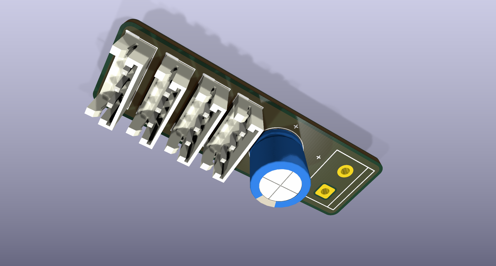

# DCHUB 四口长条分线板 v1.1

43 × 13 mm 的无源电源／信号分线板：4 个并联 X3P 三针座、独立两针电池入口及 470 µF / 16 V 电容。本项目重新绘制，**不是 Pollen Robotics 官方 1:1 板**。

[原理图 PDF](review/Schematic.pdf) · [PCB 顶面](review/PCB_top.svg) · [PCB 底面（镜像）](review/PCB_bottom_mirrored.svg) · [3D 预览](review/3D_top_iso.png)

## 下载与编辑

- `source/dchub_4port_strip_v1_1.kicad_pro`：KiCad 工程，含原理图、PCB、本地符号和封装库。
- `manufacturing/JLCPCB_UPLOAD_DCHUB_4P_LONG_v1.1.zip`：原始 Gerber／钻孔包；`gerbers/` 为逐层文件。
- `manufacturing/pcba/`：BOM、坐标与插件方向说明；装配 BOM 电容为 Rubycon `16ZLH470MEFC8X11.5`，3.5 mm 脚距。`source/` 中的原设计 BOM 仅作历史追溯。
- `review/`：原理图、PCB、钻孔与 3D 图；保留的 ERC／DRC 报告为设计时检查结果，不代表实物验收。
- `SHA256SUMS.txt`：本目录文件校验值。

板规格：2 层 FR-4，1.6 mm 厚、2 oz 铜；无安装孔。四个 X3P 电气等价，1=GND、2=VBATT、3=DATA；J5.1=GND、J5.2=VBATT。更多来源和未验证项见 [provenance.json](source/provenance.json)。

## 使用边界

这是设计资料发布。实物电流、温升、连接器承载、机械配合和最新 IMU 接线仍待验证；本板没有稳压、保险丝、反接或过流保护，不能降低电池电压。XL330 公开电压范围为 3.7–6.0 V，满电 2S 电池约 8.4 V，不能据此直接接入。

首次检查须断开电池、舵机和 IMU，先核对通断与极性，再用 5.0 V、0.20 A 限流电源空载验证；持续限流、温升、异味或极性不符立即断电。整机负载与 IMU 针序确认前不连接真机。

## 来源与许可

- 本项目本地设计：`deliverables/Microduck_DCHUB_四口长条分线板_v1.1_20260929/`；原设计／来源核对日期 2026-09-29，公开整理日期 2026-10-30。设计源无上游 Git 提交号。
- [Pollen Robot HAT](https://github.com/pollen-robotics/elec_RPI_Robot_HAT/tree/23eab11927f95ceca0dfa35bf182caeb7db39ea0)，提交 `23eab11927f95ceca0dfa35bf182caeb7db39ea0`：官方连接器与电源针序参考，Apache-2.0 原文保存在 `LICENSES/`。
- [ROBOTIS e-Manual](https://emanual.robotis.com/docs/en/dxl/x/xc330-m288/) 与 [JST EH](https://www.jst-mfg.com/product/index.php?lang=2&series=58)：制造商针序、尺寸及额定值参考，核对日期见来源文件。
- 第三方 `DCHUB.epro2` 仅作并联拓扑参考，许可未知，未再分发；原文件 SHA-256 保留在来源文件中。

上游许可与署名继续适用。本次公开不为全部自制板件额外指定统一许可，不授予商业制造授权；软件的 Apache-2.0 不自动覆盖整块板的设计。
